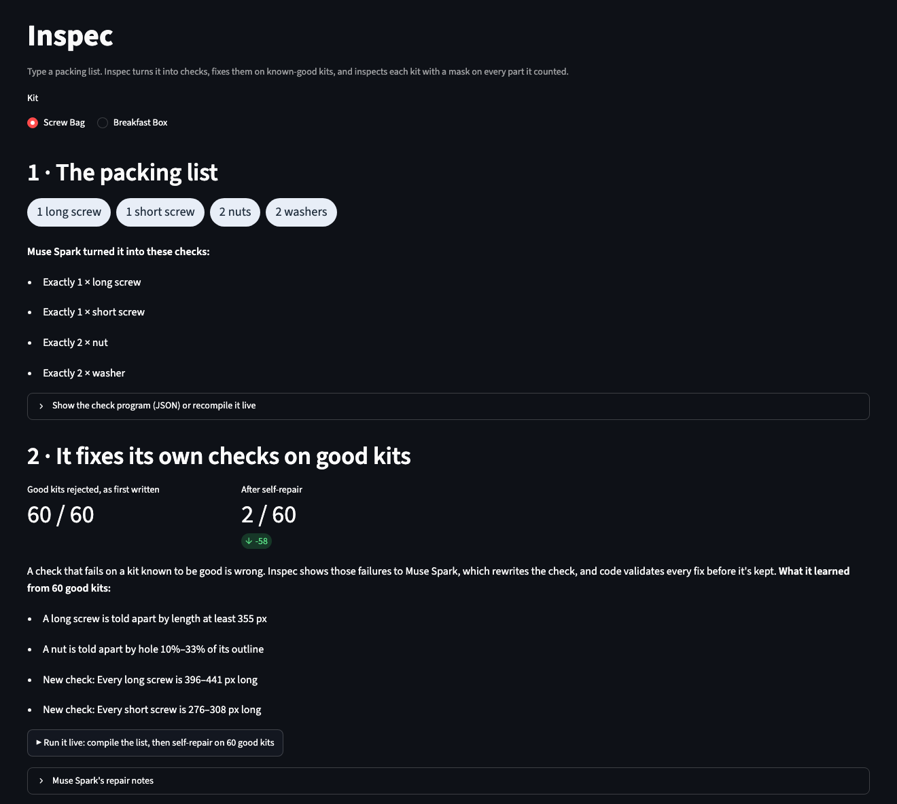

# Inspec

**Type a packing list, show Inspec a photo of the kit, and it tells you what's wrong, with a mask on
every part it counted.**

Built solo for the **Meta Global AI Developer Hackathon** (Indie Developer track, Oct 26 – Nov 4,
2026), on **Muse Spark** and **SAM 3.1**. All code in this repo was written during the event; the
commit history is the record.

- **Demo video:** _coming before submission_ ([shot list](docs/video-script.md))
- **Run it yourself:** [quick start](#quick-start), about 5 minutes plus the dataset download



## The problem

At a kitting station, a bag with two short screws instead of one long and one short looks almost
like a good one. Visual anomaly detection needs hundreds of example images per product and can't
say *which* rule broke. Asking a vision model "is this kit OK?" gives a yes or no with no evidence,
and it's weak at the thing that matters most here: measuring.

## The idea

Treat the packing list as the spec.

1. **Compile.** Muse Spark turns "1 long screw, 1 short screw, 2 nuts, 2 washers" into explicit
   checks: exactly 1 long screw, exactly 2 nuts, and so on.
2. **Find.** SAM 3.1 segments every part in the photo. Plain code counts and measures the masks
   and runs the checks.
3. **Self-repair.** The checks are run on photos of known-good kits. A check that fails on a good
   kit is wrong by definition, so Muse Spark rewrites it from the evidence and code validates the
   fix. On Screw Bag the first program rejected 60 of 60 good kits; after self-repair, 2 of 60.
   It learned, for example, that a nut's hole is a smaller share of its outline than a washer's.
4. **Look.** A mask can't see a bruise or a torn bag, so Muse Spark answers one damage question
   per packing-list item. Questions that fire on good kits are switched off.
5. **Learn from reviewers.** Kits Inspec isn't sure about go to a person. Their decisions are
   shown to Muse Spark as labelled examples on later kits.

Every verdict names the check that failed and shows the masks it measured.

## Performance

Measured on photos from MVTec LOCO AD that weren't used while building Inspec (the test set).
"Muse Spark alone" means asking Muse Spark directly, with the photo, the packing list and 3
photos of good kits.

| | Screw Bag: Inspec | Screw Bag: Muse Spark alone | Breakfast Box: Inspec | Breakfast Box: Muse Spark alone |
|---|---|---|---|---|
| Wrong parts, sizes or amounts caught | **137 / 137** | 130 / 137 | **78 / 83** | 68 / 83 |
| Damaged or contaminated caught | 71 / 82 | 69 / 82 | 68 / 90 | 70 / 90 |
| Good kits flagged by mistake | 7 / 122 | 9 / 122 | 4 / 102 | 6 / 102 |

- **Inspec is better at what can be measured**: a screw of the wrong length, too little cereal,
  items in the wrong compartment. The difference is statistically significant on both kits.
- **On damage it ties**, because that part of Inspec is also a Muse Spark call.

### Pass, review or reject

A kit is **rejected** when a count is wrong or a measurement is clearly out of range. It goes to
**review**, where a person decides, when the only problem is the model's damage judgement or a
measurement within 3% of its limit.

| | Screw Bag: reject | review | pass | Breakfast Box: reject | review | pass |
|---|---|---|---|---|---|---|
| Good kits | 1 | 6 | 115 | 0 | 4 | 98 |
| Wrong parts, sizes or amounts | 137 | 0 | 0 | 78 | 0 | 5 |
| Damaged or contaminated | 34 | 37 | 11 | 11 | 57 | 22 |

So only 1 good kit in 224 is rejected outright; the other mistakes go to a person.

### Learning from reviewers

In the app, the reviewer passes or rejects each kit sent to review. Later damage checks show
Muse Spark those reviewed kits as labelled examples ("a reviewer passed this one although almond
damage was flagged"). No model is retrained.

There are no real reviewers yet, so a simulated one passed the good training kits that were
wrongly flagged: 6 example photos for Breakfast Box, 2 for Screw Bag. On the same test kits:

| | Screw Bag: without examples | Screw Bag: with examples | Breakfast Box: without examples | Breakfast Box: with examples |
|---|---|---|---|---|
| Good kits flagged by mistake | 7 / 122 | **2 / 122** | 4 / 102 | **1 / 102** |
| Damaged or contaminated caught | 71 / 82 | **76 / 82** | 68 / 90 | **73 / 90** |

Every change goes the right way, but each is too small to be statistically significant on its
own, and the simulated reviewer is never wrong (real ones will be). Wrong-parts results don't
change.

Full results, significance tests, how often the test set was used, the Muse Spark Open (Baseten)
run and every limit: **[docs/benchmarks.md](docs/benchmarks.md)**.

## Tech stack

- **Muse Spark** (`muse-spark-1.3`, Meta Model API): compiles the packing list, proposes words
  SAM understands, repairs failing checks, answers the damage questions, and is the baseline
- **SAM 3.1** (Meta Model API): segments each part from a short noun phrase
- **Muse Spark Open** on **Baseten** (optional): the same compile and self-repair loop on the open
  model
- Python 3.11, Pydantic (check-program schema, structured output), NumPy, Pillow, OpenAI SDK
  (the Meta Model API is OpenAI-compatible), `meta-sam-parser`, Streamlit, pytest

## Quick start

```bash
git clone https://github.com/Mallard64/inspec.git && cd inspec
uv venv --python 3.11 .venv
uv pip install --python .venv/bin/python -r requirements.txt
cp .env.example .env                               # put your Meta Model API key in .env
scripts/download_loco.sh screw_bag breakfast_box   # MVTec LOCO AD, into data/ (gitignored)
.venv/bin/python -m pytest -q

# compile -> self-repair on 60 good kits -> evaluate on the test set (writes runs/<name>/)
.venv/bin/python scripts/e2e.py --calib 60 --test --name mine

.venv/bin/streamlit run app.py                     # the demo page
```

The app reads saved runs (`runs/run3` for Screw Bag, `runs/bb4` for Breakfast Box, made by
`scripts/e2e.py`). In it, **"Run it live"** compiles the list and runs self-repair against the
API, and **"Live model calls"** skips every cache for one kit and lists each Meta model call with
its time. More commands: [reproduce the results](docs/benchmarks.md#reproduce-the-results).

| Variable | Purpose |
|---|---|
| `META_API_KEY` | Meta Model API key (Muse Spark and SAM 3.1). Read from `.env`, never committed |
| `INSPEC_LLM_PROVIDER` | `meta` (default) or `baseten` |
| `BASETEN_API_KEY`, `BASETEN_MODEL` | Only for Baseten; hackathon keys work with `meta-models/muse-spark-open-1026` |

## Future steps

- **Better word choice for SAM.** Inspec tries several words for each item and keeps one SAM
  finds. When two work equally well, it should prefer the one that matches fewer objects: on
  Muse Spark Open, "dried fruit" won for the banana chips but also matched other items, so 10 of
  11 boxes missing their banana chips passed.
- **Height.** Overflowing cereal (0 of 4 caught) looks the same from above; it needs a side view
  or depth.
- **Reviewer examples with real reviewers.** The examples were tested with a simulated reviewer
  who is never wrong. Next: a review queue page, and catching reviewers who disagree with each
  other before their decisions become examples.
- **More kits and cameras.** MVTec LOCO AD has three more kinds of product, one download away;
  real phone photos of real kits haven't been tried.

## More detail

- [Benchmarks](docs/benchmarks.md): every result, significance tests, test-set use, limits
- [How it works](docs/how-it-works.md): why SAM alone isn't enough, the pipeline, the check-program
  schema, the calibration loop, project structure
- [Build log](docs/build-log.md): what was built each day, and how the work was split between me,
  Claude Code and Muse Code
- [SAM 3.1 output notes](docs/sam-output-format.md): the response format, verified against the API

## Dataset and licensing

MVTec LOCO AD (Bergmann et al.) is licensed CC BY-NC-SA 4.0. It is **not** in this repo:
`scripts/download_loco.sh` fetches it into `data/`, which is gitignored. This is a non-commercial
hackathon entry.
